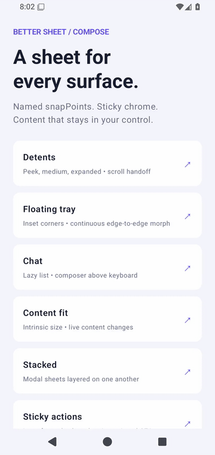
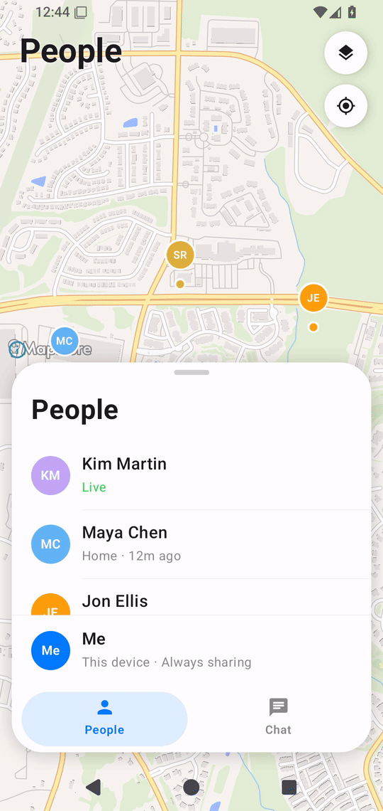
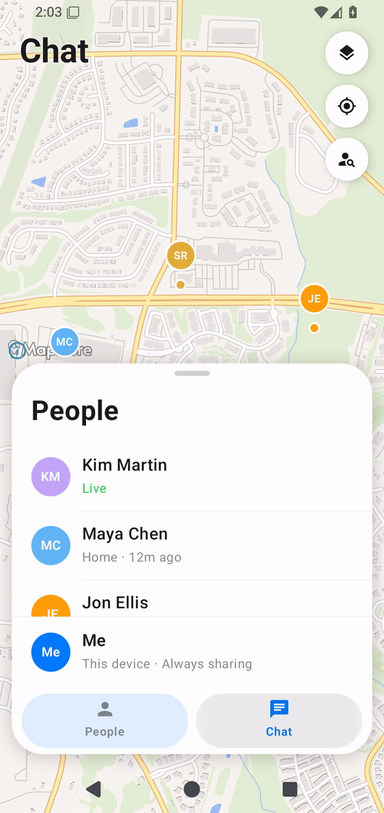
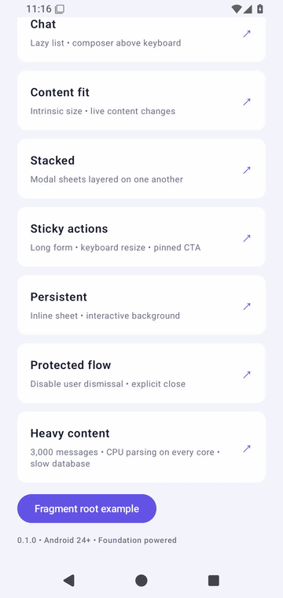

# Better Sheet

Bottom sheets for Jetpack Compose, with named snap points, a sticky header and footer, and scrolling that stays under your control.

Bring your own theme and content. Better is built on Compose Foundation, not Material. A modal sheet isolates focus in its own window. An inline sheet can sit over a screen the user can still touch.

Requires Android 24+ and Jetpack Compose.

## Install

Add JitPack, then depend on the release tag:

```kotlin
// settings.gradle.kts
dependencyResolutionManagement {
    repositories { google(); mavenCentral(); maven("https://jitpack.io") }
}

// app/build.gradle.kts
dependencies {
    implementation("com.github.andrew-levy:better-sheet:0.4.0")
}
```

To try a local build instead, run `./gradlew :better-sheet:publishToMavenLocal` and depend on `io.github.andrew-levy:better-sheet:0.4.0` with `mavenLocal()`.

The examples below use the `0.3.0` API. See the [changelog](CHANGELOG.md) for migration
from `0.2.0`. App-specific content functions are placeholders.

## Choose a sheet

| Composable | How it works |
| --- | --- |
| `BetterModalSheet` | Opens above your screen in a separate dialog window. Blocks interaction with the screen behind it. |
| `BetterSheet` | Renders inside your existing layout. Use it when the sheet should share the screen with other interactive content. |

Both are Compose components with the same state controls, snap points, and content slots.
Start with `BetterModalSheet` for a modal flow; choose `BetterSheet` for an embedded panel.

### Background interaction

`scrimEnabled` enables or removes the whole scrim: its drawing and outside-touch handling.
`scrimColor` controls appearance only; a transparent enabled scrim still catches touches.

```kotlin
BetterSheet(
    state = state,
    snapPoints = snapPoints,
    scrimColor = Color.Black.copy(alpha = 0.42f), // Used only when enabled.
    behavior = SheetBehavior(scrimEnabled = false),
) {
    Content()
}
```

| Configuration | Outside touches |
| --- | --- |
| `scrimEnabled = true` (default), `dismissOnScrim = true` | Dismiss the sheet; do not reach the background |
| `scrimEnabled = true`, `dismissOnScrim = false` | Blocked without dismissing the sheet |
| `scrimEnabled = false` | No scrim or dimming; touches reach the background of an inline sheet |

`Color.Transparent` and `Color.Unspecified` both draw no dimming and never change touch
behavior. `BetterModalSheet` always blocks background interaction through its window.
With its scrim disabled, outside taps do not dismiss it. Back and `state.hide()` still
work according to their own settings. Use `BetterSheet` for touch-through.

### Fragment support

Neither component requires a Fragment. If your app uses Fragments, put either component
inside a `ComposeView`. Use `BetterSheet` to render in the Fragment's view, or
`BetterModalSheet` to open a dialog above it. Call `state.hide()` to close the sheet,
then remove or pop the Fragment in `onDismissed`.

## BetterModalSheet: a modal above your screen



Use this for a modal in an ordinary Compose screen. No Fragment or separate visibility
boolean is needed.

```kotlin
val state = rememberSheetState(
    initialSnapPoint = "medium",
    initiallyVisible = false,
)
val scope = rememberCoroutineScope()

Button(onClick = { scope.launch { state.show() } }) { Text("Open order") }

BetterModalSheet(
    state = state,
    snapPoints = listOf(
        SheetSnapPoint.fixed("peek", 260.dp),
        SheetSnapPoint.fraction("medium", 0.6f),
        SheetSnapPoint.expanded(),
    ),
    header = { Text("Order") },
    footer = {
        Button(onClick = { scope.launch { state.hide() } }) { Text("Done") }
    },
) {
    OrderDetails()
}
```

Keep `BetterModalSheet` mounted and control visibility with `state.show()` / `state.hide()`. Its dialog is removed after dismissal. `onDismissed` is optional; callers may still remove the composable in that callback.

```kotlin
scope.launch { state.animateTo("peek") }
scope.launch { state.expand() }
scope.launch { state.collapse() }
scope.launch { state.hide() }
```

`currentSnapPoint` is the snap point the sheet has settled on, or `null` while it is hidden. `progress` is the visible height from `0` to `1`.

## Snap points



| Factory | Height |
| --- | --- |
| `fixed("peek", 260.dp)` | An exact height, including the handle, header, and footer |
| `fraction("medium", 0.6f)` | A fraction of the space above the navigation bar and keyboard |
| `fitContent()` | As tall as the body needs, plus the header and footer |
| `expanded()` | The full height under the status bar, minus `topMargin` |
| `custom("reading") { … }` | Your own height from `availableHeight`, `contentHeight`, and `chromeHeight` |

Ids must be unique. Two snap points that land on the same height share one position; the first id you declared is the one dragging settles on.

`fitContent()` measures the body, so use it with ordinary content, not a lazy list.

## Let the content scroll first

Content owns a gesture if it scrolls at the start. Reaching an edge during that drag or its fling stops the list without moving the sheet. Start a new gesture at the edge to move the sheet. Each edge is independently configurable:

```kotlin
SheetBehavior(bubbleAtTop = true, bubbleAtBottom = false)
```

`bubbleAtTop` allows a new downward drag at the physical top to collapse or dismiss the sheet. `bubbleAtBottom` allows a new upward drag at the physical bottom to expand it. Both default to `true`; either or both can be disabled. Physical edges are independent of message order or reverse layout. Dragging the handle still moves the sheet directly.

Keep a chat list top-aligned. `reverseLayout = true` pins messages to the bottom, so growing the sheet moves the top edge and leaves the bubbles in place. Put the composer in `footer`, not in the list. Better does not scroll to new messages for you.

Lazy content cannot use `fitContent()`, because items that are not composed have no height. Use `SheetBodyMode.Fill` and fixed, fractional, or custom snap points:

```kotlin
BetterModalSheet(
    state = state,
    snapPoints = snapPoints,
    bodyMode = SheetBodyMode.Fill,
    behavior = SheetBehavior(
        keyboardBehavior = SheetKeyboardBehavior.Expand,
        bubbleAtTop = true,
        bubbleAtBottom = true,
    ),
    footer = { ChatComposer() },
) {
    LazyColumn(Modifier.fillMaxSize(), state = listState) {
        items(messages, key = { it.id }) { MessageBubble(it) }
    }
}
```

## Motion

The default settle uses a short, critically damped spring with no bounce past the snap point. Dragging between snap points tracks your finger. Dragging past the top, or past the bottom when the sheet is not allowed to close, resists and springs back. A sheet that can close still follows your finger off the screen.

The dimming fades with that drag until the lowest snap point, then stays fully dim. To keep it at full strength the whole time the sheet is visible:

```kotlin
SheetBehavior(scrimFollowsDrag = false)
```

`scrimColor = Color.Unspecified` still removes the dimming.

## Keyboard



Do not add `imePadding()` around the sheet. Better already keeps the sheet above the keyboard.

| `keyboardBehavior` | What happens |
| --- | --- |
| `Resize` | The sheet keeps its snap point and shortens to fit above the keyboard. This is the default. |
| `Expand` | The sheet also jumps to its largest snap point, then returns to the previous one when the keyboard closes. |
| `Ignore` | The keyboard is ignored. Fine for a sheet with nothing to type. |

## Edge to edge

Call `enableEdgeToEdge()` with transparent system-bar styles. The default navigation-bar style paints its own scrim, which shows up as a darker strip:

```kotlin
enableEdgeToEdge(
    statusBarStyle = SystemBarStyle.light(
        android.graphics.Color.TRANSPARENT,
        android.graphics.Color.TRANSPARENT,
    ),
    navigationBarStyle = SystemBarStyle.light(
        android.graphics.Color.TRANSPARENT,
        android.graphics.Color.TRANSPARENT,
    ),
)
```

The dimming covers the status bar and navigation bar, so the sheet and the screen read as one surface. The sheet's own color continues behind the navigation buttons. Content stays in the safe area.

## BetterSheet: a sheet inside your layout

Use `BetterSheet` in a full-size `Box` alongside your Compose screen. It fills its parent,
opens on mount by default, and animates closed when you call `hide()`. Set
`behavior = SheetBehavior(scrimEnabled = false)` to keep the background interactive outside the sheet.
An inline sheet does not provide the separate-window focus isolation of `BetterModalSheet`.



*This recording shows the shared sheet surface in the modal demo; the inline variant uses
that same resizing and scrolling implementation inside your layout.*

```kotlin
val state = rememberSheetState(initialSnapPoint = "peek")
val scope = rememberCoroutineScope()

Box(Modifier.fillMaxSize()) {
    MapScreen()
    BetterSheet(
        state = state,
        snapPoints = listOf(
            SheetSnapPoint.fixed("peek", 220.dp),
            SheetSnapPoint.expanded(),
        ),
        scrimColor = Color.Unspecified,
        behavior = SheetBehavior(scrimEnabled = false),
        header = { Text("Nearby places") },
        footer = {
            Button(onClick = { scope.launch { state.hide() } }) { Text("Close") }
        },
    ) {
        PlaceFilters()
    }
}
```

To open it later, use `rememberSheetState(initiallyVisible = false)` and call `state.show()`.
Keep the sheet mounted to reopen it. If your navigation owns removal, perform that in
`onDismissed` after closing. Removing the composable immediately skips its exit animation.

### Using BetterSheet as a Fragment root

This example uses `BetterSheet` because it renders within the Fragment's own view. A
Fragment can also host `BetterModalSheet` when modal window behavior is desired; its
`onDismissed` callback can remove or pop the Fragment in the same way.

Use `BetterSheet` inside a `ComposeView`. Tie the composition to the Fragment's
view lifecycle, and have the close button call `hide()` before removing the Fragment:

```kotlin
class OrderSheetFragment : Fragment() {
    override fun onCreateView(
        inflater: LayoutInflater,
        container: ViewGroup?,
        savedInstanceState: Bundle?,
    ): View = ComposeView(requireContext()).apply {
        // Define a stable ID in res/values/ids.xml for saved Compose state.
        id = R.id.order_sheet_content
        setViewCompositionStrategy(
            ViewCompositionStrategy.DisposeOnViewTreeLifecycleDestroyed,
        )
        setContent {
            val state = rememberSheetState(initialSnapPoint = "medium")
            val scope = rememberCoroutineScope()
            BetterSheet(
                state = state,
                snapPoints = listOf(
                    SheetSnapPoint.fraction("medium", 0.6f),
                    SheetSnapPoint.expanded(),
                ),
                onDismissed = {
                    parentFragmentManager.beginTransaction()
                        .remove(this@OrderSheetFragment)
                        .commit()
                },
                footer = {
                    Button(onClick = { scope.launch { state.hide() } }) { Text("Done") }
                },
            ) {
                OrderDetails()
            }
        }
    }
}
```

Mount the Fragment in a full-window container so the scrim can cover the background. For
back-stack navigation, replace the removal callback with your navigation's pop operation.
The sheet handles Back while visible. Avoid a second Fragment slide transition on the same view.
See the runnable [Fragment sample](sample/src/main/java/dev/better/sheet/sample/FragmentDemoActivity.kt).

`BetterSheetHost` remains a lower-level public rendering API. Prefer `BetterSheet` for inline
usage with managed entry/exit and `onDismissed`.

## Stack sheets


Share one `rememberSheetStackState()` between ordinary modal sheets. There is no stack
composable, route registration, push/pop navigation, or second visibility boolean.
Keep the modals mounted and use their own `SheetState.show()` / `hide()` methods.

```kotlin
val stackState = rememberSheetStackState()
val friends = rememberSheetState()
val profile = rememberSheetState(initiallyVisible = false)
val scope = rememberCoroutineScope()
val recede = Modifier.sheetStackEffect { entry ->
    val depth = entry.animatedDepth
    scaleX = (1f - 0.06f * depth).coerceAtLeast(0.7f)
    scaleY = (1f - 0.04f * depth).coerceAtLeast(0.8f)
    translationY = (-12).dp * depth
    cornerRadius = (28 + 8 * depth).dp
}

BetterModalSheet(
    state = friends, stackState = stackState,
    snapPoints = listOf(SheetSnapPoint.expanded()),
    surfaceModifier = recede,
) {
    Button(onClick = { scope.launch { profile.show() } }) { Text("Open profile") }
}
BetterModalSheet(
    state = profile, stackState = stackState,
    snapPoints = listOf(SheetSnapPoint.fraction("expanded", 0.6f)),
    surfaceModifier = recede,
) {
    Button(onClick = { scope.launch { profile.hide() } }) { Text("Close") }
}
```

- `animatedDepth` sums the visible progress of **every** sheet above this one. Three
  settled layers have depths 2, 1, 0; the example gives widths 88%, 94%, 100%.
  Opening a third sheet moves the back layer smoothly from 1 to 2. Dismissing or
  reversing the gesture updates every underlying layer from the actual positions.
- Each sheet contributes zero while hidden, one at its smallest snap point, clamped above
  that snap point. `coveredProgress` exposes only the immediately covering sheet's progress.
  `depth` is the integer count above; `isTopmost` identifies the active layer.
- Hidden mounted modals create no dialog and do not count toward depth. A shown modal
  joins at the top, remains through its completed exit, then unregisters. Showing an
  already-presented modal does not reorder it. Simultaneous first presentations use
  composition order; open sequentially when a specific ordering is needed.
- `onDismissed` is optional and runs after the exit completes. Existing callers
  may still remove the composable there; mounted callers can leave it in place and
  later call `show()` again. Modal content leaves composition while hidden: hoist any
  content state that must survive reopening outside the modal.
- `LocalSheetStackEntry.current` is nullable outside coordinated modal content.
  Use it in a custom composed modifier for dynamic side padding. Scaling preserves
  layout and shrinks text; padding changes width and can reflow content.
- The effect supports scale, translations in `Dp`, alpha, transform origin and optional
  top-corner clipping. Clipping adds to the base shape; it cannot undo that base clip.
  Effects apply only to `surfaceModifier`, leaving the full-screen scrim unchanged.
- Sheets without `stackState` remain independent; `sheetStackEffect` is a no-op there.
  Share each stack only among modals in one host window. Separate stack instances do
  not coordinate. Inline/Fragment sheets are not enrolled in this modal coordinator.
- Each remembered `SheetState` restores its visibility/snap point after Activity recreation.
  Stack ordering itself is transient and rebuilt in composition order on restoration;
  this coordinator does not own or persist app navigation.

The **Stacked sheets** sample uses three always-mounted modals with cumulative recession.

## Common parameters

These parameters are shared by `BetterModalSheet` and `BetterSheet`, except `stackState`.

| Parameter | Default | When to change it |
| --- | --- | --- |
| `state` | Required for modal; remembered for inline | Hoist it to open, close, or change the snap point |
| `snapPoints` | Required | Choose fixed, fractional, content-fit, or custom heights |
| `onDismissed` | No-op | Update navigation or notify the parent after dismissal |
| `header` / `footer` | `null` | Keep a title, actions, or chat composer outside the scrolling body |
| `bodyMode` | `SheetBodyMode.Scroll` | Use `Fill` for caller-owned scrolling such as a `LazyColumn` |
| `dragHandle` | `SheetDragHandle()` | Supply a custom composable or `null` to hide it |
| `behavior` | `SheetBehavior()` | Configure dragging, dismissal, keyboard, or scroll handoff |
| `maxWidth` / `topMargin` | `640.dp` / `24.dp` | Tune tablet width and space above the expanded sheet |
| `containerColor` / `contentColor` | White / dark blue-gray | Apply your theme; custom content can read `LocalSheetContentColor` |
| `scrimColor` | Black at 42% alpha | Tune dimming; `Color.Unspecified` or `Color.Transparent` draws no dimming |
| `shape` | Rounded top corners, `28.dp` | Customize the base surface shape |
| `modifier` | `Modifier` | Customize the full host container |
| `surfaceModifier` | `Modifier` | Customize the sheet surface, including stack effects |
| `title` | `"Bottom sheet"` | Set the accessibility pane title; this does not render a visible header |
| `stackState` | `null` (modal only) | Coordinate multiple modal sheets |

Removing a modal's scrim does not make its separate window behave like an inline sheet.
Choose `BetterSheet` when you need interaction with the screen behind it.

### Sticky header and footer


```kotlin
BetterModalSheet(
    state = state,
    snapPoints = listOf(SheetSnapPoint.expanded()),
    bodyMode = SheetBodyMode.Fill,
    header = { Text("Messages") },
    footer = { ChatComposer() },
) {
    LazyColumn(Modifier.fillMaxSize()) {
        items(messages, key = { it.id }) { MessageBubble(it) }
    }
}
```

### Keep a flow from being dismissed

```kotlin
SheetBehavior(
    dismissOnDrag = false,
    dismissOnScrim = false,
    dismissOnBack = false,
)
```

The user cannot drag it away, tap the dimming, or press Back to close it. `state.hide()` still closes it when your own button says so.

### Scroll handoff tuning

Header drags resize the sheet with the body attached below the header: a normal
`LazyColumn` preserves its first visible item and reveals more content below.
Use `SheetBodyMode.Fill` for caller-owned lists. A `reverseLayout = true` list anchors
its items to the bottom instead; use chronological items in a normal list for
this top-attached expansion behavior.

```kotlin
SheetBehavior(
    bubbleAtTop = true,             // New downward gesture at the top collapses
    bubbleAtBottom = false,         // Upward gestures at the bottom do not expand
    transferScrollFling = true,     // Preserve release speed after dragging the sheet
    scrollFlingThreshold = 500f,    // Minimum release speed in dp/s
    scrollFlingVelocityScale = .5f, // Scale sheet gesture release velocity (0..1)
)
```

List fling momentum never initiates a sheet drag, regardless of these settings.
`transferScrollFling` only controls release momentum for a gesture that already
moved the sheet. A partially dragged sheet always settles to a snap point. Header
flicks are independent of these settings. Nested scrolling stops at the sheet
bounds without engaging the header's rubber-band effect.


## Run the sample

Open the project in Android Studio and run `sample` on Android 24+, with JDK 17 and Android SDK 35.

```bash
./gradlew :sample:assembleDebug :better-sheet:testDebugUnitTest
```

### Floating tray

Use the same sheet with an iOS-inspired floating surface that joins the edges as it expands:

```kotlin
BetterSheet(
    state = state,
    snapPoints = listOf(
        SheetSnapPoint.fraction("medium", 0.6f),
        SheetSnapPoint.expanded(),
    ),
    presentation = SheetPresentation.Tray(),
) {
    // Your content
}
```

Available on `BetterSheet`, `BetterSheetHost`, and `BetterModalSheet`. Defaults are 12.dp side
and bottom gaps, 32.dp fallback corners, 28.dp expanded top corners, and morphing over the final
40% of available height. Customize with `horizontalInset`, `bottomInset`, `cornerRadius`,
`expandedCornerRadius`, `morphStartFraction`, and `matchDeviceCorners`. Android 12+ reported
window corners inform the collapsed radius; use `matchDeviceCorners = false` for an explicit
radius. Matching applies to collapsed corners; expanded top corners use `expandedCornerRadius`.
Unavailable metadata, embedded hosts, and width-capped surfaces use the configured fallback.
This matches a reported circular radius, not every device's physical corner contour. Tray owns its shape; `shape` remains the Standard presentation's setting.

Dragging, reversing, and programmatic snap changes all drive the same morph. Short sheets stay
floating; navigation/keyboard safe areas remain protected. The existing `maxWidth` still applies
on tablets. This adds the geometry, not Liquid Glass blur/refraction. Try **Floating tray** in
the sample gallery or the people sheet in the Find My sample. Reproduce the recording with
`python3 scripts/record-demos.py tray`.


## License

Apache 2.0. See [CHANGELOG](CHANGELOG.md), [architecture](docs/ARCHITECTURE.md), and [contributing](CONTRIBUTING.md).
