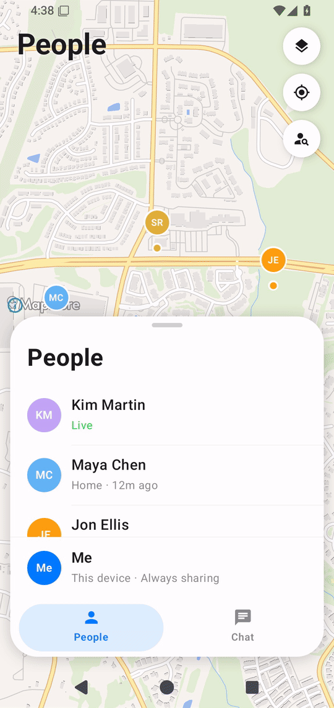
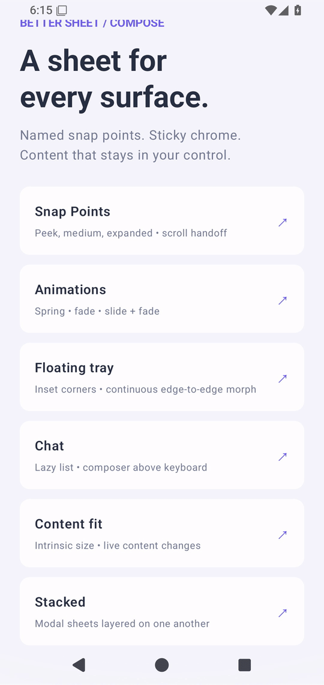

# Better Sheet

Bottom sheets for Jetpack Compose that move and feel the way your app needs.
Named snap points, smooth scroll handoff, sticky headers and footers, and standard Compose animations. Built on Compose Foundation, with no Material dependency—bring your own theme and content.

<table>
  <tr>
    <th>Snap points</th>
    <th>Floating tray</th>
    <th>Stacked sheets</th>
  </tr>
  <tr>
    <td><a href="docs/videos/snapPoints.mp4"></a></td>
    <td><a href="docs/videos/tray.mp4"></a></td>
    <td><a href="docs/videos/stacked.mp4"></a></td>
  </tr>
</table>

Click a preview for the full-resolution MP4. Recorded in the Find My app, in light mode. More demos: [tabs](docs/videos/tabs.mp4) · [chat & keyboard](docs/videos/chat.mp4) · [content sizing](docs/videos/contentFit.mp4) · [scroll handoff](docs/videos/scrollHandoff.mp4).

**Android 24+ · Compose 1.9+** · [Usage guide](docs/USAGE.md) · [Sample apps](#sample-apps) · [Changelog](CHANGELOG.md)

## Install

```kotlin
// settings.gradle.kts — dependencyResolutionManagement.repositories
maven("https://jitpack.io")

// app/build.gradle.kts
implementation("com.github.andrew-levy:better-sheet:0.6.2")
```

See [migration notes](docs/USAGE.md#animation-behavior-and-migration) when upgrading from 0.5.0.
Examples use `dev.better.sheet.*`; app-specific content functions are placeholders.

## Your first sheet

Keep the sheet mounted and use its state to open, resize, or close it.

```kotlin
val state = rememberSheetState("medium", initiallyVisible = false)
val scope = rememberCoroutineScope()

Button(onClick = { scope.launch { state.show() } }) { Text("Open") }

BetterModalSheet(
    state = state,
    snapPoints = listOf(
        SheetSnapPoint.fraction("medium", 0.5f),
        SheetSnapPoint.expanded(),
    ),
    header = { Text("Your title") },
    footer = {
        Button(onClick = { scope.launch { state.hide() } }) { Text("Done") }
    },
) {
    SheetContent()
}
```

Headers and footers stay in place while the body scrolls. `onDismissed` runs after the exit
finishes; use it to update navigation. Removing a sheet immediately skips the exit animation.

| Component | Use it for |
| --- | --- |
| `BetterModalSheet` | A modal above the screen, in its own dialog window |
| `BetterSheet` | An inline panel inside your layout, with optional background interaction |

Both share snap points, content slots, and animation controls. [Inline and Fragment examples →](docs/USAGE.md#inline-sheets)

## Snap points & state

| Snap point | Height |
| --- | --- |
| `SheetSnapPoint.fixed("peek", 260.dp)` | Exact height, including header and footer |
| `SheetSnapPoint.fraction("half", 0.5f)` | Fraction of available height |
| `SheetSnapPoint.fitContent()` | Fits finite content; use fixed/fractional points for lazy lists |
| `SheetSnapPoint.expanded()` | Full available height, respecting `topMargin` |
| `SheetSnapPoint.custom("reading") { … }` | Calculated from available, content, and chrome heights |

Give each point a unique ID. Call state methods inside a coroutine, such as `scope.launch { … }`.

| Method | Result |
| --- | --- |
| `show()` / `hide()` | Open at the last requested point / close |
| `snapTo("half")` | Animate to a named point |
| `jumpTo("half")` | Move immediately, without entrance or snap animation |
| `expand()` / `collapse()` | Animate to the largest / smallest point |

Read `currentSnapPoint`, `targetSnapPoint`, `isVisible`, `isAnimationRunning`, or `progress`
to coordinate your UI.

## Animations

Use Compose's `fadeIn`, `slideInVertically`, `scaleIn`, and their exit counterparts.
Combine transitions with `+`; configure snap movement separately.

```kotlin
BetterModalSheet(
    state = state,
    snapPoints = snapPoints,
    enterTransition = fadeIn(tween(220)),
    exitTransition = fadeOut(tween(180)),
    snapAnimationSpec = spring(dampingRatio = 0.8f, stiffness = 350f),
) {
    SheetContent()
}
```

Defaults use a vertical slide and a critically damped spring. Dragging follows your finger;
release settles with `snapAnimationSpec`. The same controls work on inline sheets.
Try spring, fade, and slide + fade in the sample app’s **Animations** gallery.

## Scrolling & keyboard

For a `LazyColumn`, use `SheetBodyMode.Fill` so your list owns scrolling. Put fixed actions
or a chat composer in `footer`. Finite content scrolls automatically with the default body mode.

```kotlin
BetterModalSheet(
    state = state,
    snapPoints = snapPoints,
    bodyMode = SheetBodyMode.Fill,
    behavior = SheetBehavior(
        bubbleAtTop = true,
        bubbleAtBottom = false,
        keyboardBehavior = SheetKeyboardBehavior.Expand,
    ),
    footer = { ChatComposer() },
) {
    LazyColumn(Modifier.fillMaxSize()) {
        items(messages, key = { it.id }) { MessageBubble(it) }
    }
}
```

A gesture that starts by scrolling stays with the content. Start a new gesture at an edge
to move the sheet; `bubbleAtTop` and `bubbleAtBottom` control each edge independently
(both default to `true`). [Handoff details →](docs/USAGE.md#scroll-handoff)

| Keyboard behavior | Result |
| --- | --- |
| `Resize` (default) | Keep the snap point and fit above the keyboard |
| `Expand` | Temporarily expand, then restore the previous point |
| `Ignore` | Leave sizing unchanged |

The sheet handles keyboard insets; no extra `imePadding()` is needed.

## Appearance & behavior

Set `containerColor`, `contentColor`, `shape`, and `dragHandle` to match your app.
Use `header` / `footer` for sticky content, and `maxWidth` / `topMargin` to tune sizing.

| Want to… | Set |
| --- | --- |
| Use a floating tray | `presentation = SheetPresentation.Tray()` |
| Coordinate modal layers | Share `stackState = rememberSheetStackState()` between modals |
| Customize how layers recede | `surfaceModifier = Modifier.sheetStackEffect { … }` |
| Keep an inline background interactive | `behavior = SheetBehavior(scrimEnabled = false)` |
| Change dimming only | `scrimColor = Color.Black.copy(alpha = 0.3f)` |
| Disable user dismissal | `SheetBehavior(dismissOnDrag = false, dismissOnScrim = false, dismissOnBack = false)` |

A modal window always blocks background interaction. Scrim color only controls appearance;
`scrimEnabled` controls drawing and outside-touch handling. `state.hide()` still works when
user dismissal is disabled.

[All parameters](docs/USAGE.md#parameters) · [Stacking](docs/USAGE.md#stacking) · [Tray options](docs/USAGE.md#floating-tray) · [Edge-to-edge setup](docs/USAGE.md#edge-to-edge)

## Sample apps

Open in Android Studio with JDK 17 and SDK 35, then run either app on Android 24+.

| App | Includes |
| --- | --- |
| [`sample`](samples/sample) | Snap points, animation presets, chat, content sizing, stacking, scroll handoff, trays, and Fragments |
| [`findmy`](samples/findmy) | An interactive map with an inline people sheet |

```bash
./gradlew :sample:assembleDebug :findmy:assembleDebug
```

[Contributing & recording demos](CONTRIBUTING.md) · [Architecture](docs/ARCHITECTURE.md) · [Apache 2.0 license](LICENSE)
